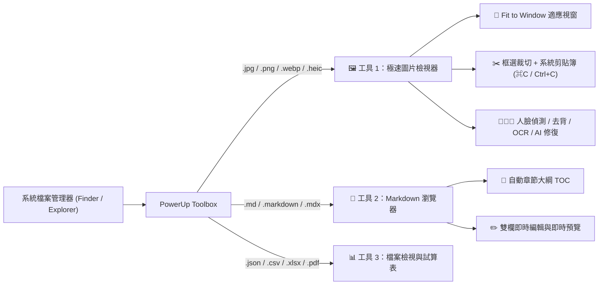

# 🧰 PowerUp Toolbox — 極速多媒體檢視器 ＋ 跨平台生產力工具箱

> **支援平台**：macOS (Apple Silicon & Intel) / Windows 10 & 11  
> **開源儲存庫**：[https://github.com/become/powerup-toolbox](https://github.com/become/powerup-toolbox)

---

## 🪟 Windows 快速開始 (Quick Start)

在 Windows 10 / 11 上無需編譯任何原生模組，只需以下 3 步即可 1 秒啟動：

```cmd
git clone https://github.com/become/powerup-toolbox.git
cd powerup-toolbox
run_windows.bat
```

* `run_windows.bat` 會自動檢測 Python 環境、自動安裝必備的 `Pillow` 影像處理套件，並自動以瀏覽器開啟工具箱介面。
* 詳細的架構決策與功能對應表請參考：[Windows 跨平台開發架構規劃書](docs/WINDOWS_DEVELOPMENT_PLAN.md)。

---

## 🍎 macOS 快速安裝與啟動

### 方式一：下載現成安裝包
- [下載最新 MacToolbox-latest.dmg](https://raw.githubusercontent.com/become/powerup-toolbox/main/dist/MacToolbox-latest.dmg)
- [下載最新 MacToolbox-latest.pkg](https://raw.githubusercontent.com/become/powerup-toolbox/main/dist/MacToolbox-latest.pkg)

### 方式二：從原始碼啟動
```bash
python3 server.py
# 開啟瀏覽器訪問 http://127.0.0.1:18765/
```

---

## 🚀 核心功能與工具特色



### 🖼️ 工具一：極速圖片檢視器 (`Alt + 1`)
- **Fit to Window**：按 `W` 鍵自動等比例放大或縮小至填滿視窗；按 `↔️` 適寬或 `1` 切換 1:1 原寸。
- **0 延遲切換**：`←` / `→` 或滑鼠滾輪，內建 Ring Buffer 預載前後圖片。
- **自由 / 等比裁切**：滑鼠拖曳框選（`自由`、`3:4`、`1:1`），一鍵寫入系統剪貼簿或另存新檔。
- **智慧視覺工具**：支援人臉自動對焦放大、一鍵去背透明 PNG、OCR 圖片文字提取。
- **AI 影像增強**：本地支援 GFPGAN、CodeFormer、超解析度修復與自動上色。

### 📝 工具二：Markdown 瀏覽器 (`Alt + 2`)
- **📑 自動章節大綱 (TOC)**：自動擷取 `H1` ~ `H4` 標題，點擊平滑捲動定位。
- **📐 滿版與版面設定**：標準寬度 (880px) 與 100% 全寬適應視窗。
- **🎨 多種閱讀主題**：深色、亮色、暖色護眼，以及字體大小即時縮放。
- **✏️ 雙欄即時編輯**：左邊編輯原始碼，右邊零延遲同步渲染 Mermaid 圖表與語法高亮。
- **🔄 背景檔案監控 (Live Reload)**：當背景工具修改檔案時自動無感刷新。
- **📋 一鍵複製富文本**：直接複製為 Rich Text，貼入 Word、Pages、Notion 不跑版。

### 📊 工具三：試算表與數據檢視 (`Alt + 3`)
- **JSON 檢視器**：樹狀展開折疊、關鍵字過濾搜尋、節點複製。
- **CSV / Excel (`.xlsx`, `.xls`) 檢視器**：分頁切換、資料表自適應渲染。
- **PDF 閱覽**：高解析度頁面渲染與導覽。

---

## 🛠️ 技術架構與跨平台相容性

- **前端**：純原生 HTML5 + CSS3 + 現代 JavaScript (Vanilla JS, ES Modules)，零肥大框架依賴。
- **後端**：Python 3 標準庫 `http.server.ThreadingHTTPServer`，極速輕量。
- **跨平台抽象**：
  - **檔案總管定位**：macOS Finder (`open -R`) / Windows 檔案總管 (`explorer.exe /select,`)
  - **原生檔案選取**：macOS AppleScript / Windows PowerShell WinForms
  - **剪貼簿整合**：macOS NSPasteboard / Windows Clipboard API
- 詳細 Windows 開發進度與規劃請見 [docs/WINDOWS_DEVELOPMENT_PLAN.md](docs/WINDOWS_DEVELOPMENT_PLAN.md)。
