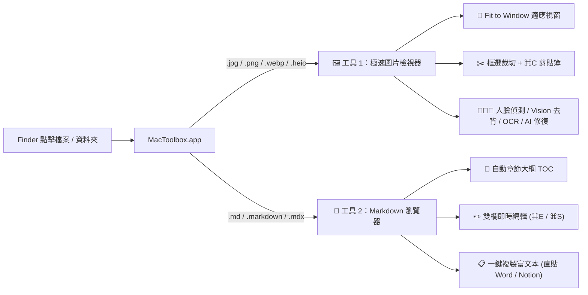

# 🧰 MacToolbox — 極速圖片檢視器 ＋ Markdown 瀏覽器

> [!TIP]
> 你現在看到的就是 **MacToolbox 的「📝 Markdown 瀏覽器」**！
> 左側欄已自動為你掃描目前資料夾與 `~/Claude/Projects` 最近修改的所有 `.md` 文件，點一下就能秒切預覽；右側則是自動解析生成的 **📑 章節大綱 (TOC)**。

---

## 🚀 兩大核心工具

---

## 🖼️ 工具一：極速圖片檢視器 (`Alt + 1`)

| 快捷鍵 / 按鈕 | 功能說明 |
| :--- | :--- |
| **`W` 或「📐 適應視窗」** | **Fit to Window**：無論是大圖還是小圖，自動等比例放大或縮小至剛好填滿視窗！ |
| **`↔️ 適寬` / `1` (`1:1 原寸`)** | 一鍵切換「適應視窗寬度（長截圖神器）」或「1:1 原始像素大小」 |
| **`←` / `→` 或 滑鼠滾輪** | **0 延遲高速切換前後張照片**（內建 Ring Buffer 自動預載前後 8 張圖） |
| **`Space` / `G` / `C`** | 切換「單圖檢視」、「高密度縮圖牆 (Grid)」、「A/B 雙圖同步放大比對」 |
| **滑鼠拖曳拉框 + `⌘C`** | 自由或固定比例（`3:4`、`1:1`）框選後按 `⌘C`，**直接寫入 Mac 系統剪貼簿**貼到 LINE / 簡報 |
| **`S` / `⌘V`** | **呼叫 Mac 原生十字準星框選截圖 (`screencapture -i`)** 或直接貼上剪貼簿截圖 |
| **`F` / `Tab`** | **AI 臉部偵測**：自動標出所有人臉與清晰度分數，點擊小頭像瞬間放大對焦或一鍵套用 3:4 證件照框 |
| **Vision 去背 / OCR / AI** | 原生 Apple Vision 一鍵去背透明 PNG 複製、繁中/英文 OCR 辨識、GFPGAN/CodeFormer/DDColor 與 Codex CLI |

---

## 📝 工具二：Markdown 瀏覽器 (`Alt + 2`)

> [!NOTE]
> 在 Finder 對任何 `.md` 檔案按 `⌘I`（取得資訊）➔「打開檔案的應用程式」選擇 **`MacToolbox (看圖 + Markdown)`** ➔ 點選「全部更改…」，以後雙擊任何 `.md` 就會直接用這個閱讀器秒開！

* **📑 自動章節大綱 (TOC)**：自動擷取 `H1` ~ `H4` 標題於右側欄，點擊平滑捲動定位。
* **📐 Fit Window 滿版切換**：支援「📄 標準閱讀寬度 (880px)」與「📐 Fit Window 全寬滿版 (100%)」。
* **🎨 三種閱讀主題 + 字級縮放**：支援 `🌙 深色`、`☀️ 亮色`、`📜 暖色護眼`，以及 `A-` / `A+` 字體大小調整。
* **✏️ 雙欄即時編輯 (`⌘E` 開關 / `⌘S` 儲存)**：左邊修改 Markdown 原始碼，右邊 0 延遲同步渲染預覽（含 Mermaid 圖表與程式碼高亮），按 `⌘S` 直接存回原檔。
* **🔄 背景檔案即時監控 (Live Reload)**：當 Claude 或 Codex 在背景更新 `.md` 檔案時，畫面每 2 秒自動無感刷新！
* **📋 一鍵複製富文本**：直接將渲染後的排版、表格、粗體複製為 Rich Text，貼進 Word / Pages / Notion / Email 不跑版！
